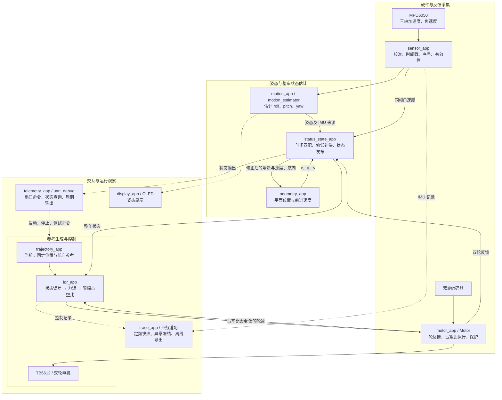

# balance_car · 双轮自平衡小车

这是一个基于 LQR 控制的双轮自平衡小车项目，主控为 STM32F103C8T6，搭配 MPU6050、SSD1306 OLED 和 TB6612 电机驱动。项目使用硬件 I2C2 连接传感器与显示屏，通过 USART2 / HC-05 进行串口调试和数据输出。

## 架构总览

项目围绕“采集反馈 → 估计整车状态 → 计算控制输出 → 执行电机命令”组织。MPU6050 和编码器提供测量，姿态与里程计模块完成估计，状态空间模块统一检查、组合数据；LQR 消费整车状态和轨迹参考，计算双轮力矩，并换算为占空比输出。



图中实线表示主要数据与控制关系，虚线表示交互或观察关系；箭头不表示独立线程。主循环组织采集、姿态更新、电机采样、整车状态更新、轨迹参考和 LQR 控制，统一微秒时间基准由 `timebase` 提供。显示、串口等任务由调度器配合执行。

### 状态空间与数据来源

整车状态模块发布七个物理量：`[x, y, theta, psi, v, theta_dot, psi_dot]`。

| 状态量 | 含义 | 计算来源 |
| --- | --- | --- |
| `x_m`、`y_m` | 轮轴中心在平面参考系中的位置 | 双轮位移增量、车身俯仰补偿与航向，由里程计累计 |
| `theta_rad` | 车身俯仰角 | 姿态模块的 pitch |
| `psi_rad` | 连续展开的偏航角 | 姿态模块的 yaw，由状态模块展开 |
| `v_mps` | 沿车体前进方向的有符号速度 | 双轮速度经俯仰补偿后取平均 |
| `theta_dot_radps`、`psi_dot_radps` | 俯仰角与偏航角的变化率 | 同帧陀螺仪角速度结合姿态，转换为欧拉角导数 |

MPU6050 测得的是加速度和角速度，不直接提供平移速度或位置。`motion_app` 是依赖 IMU 数据的软件姿态估计模块；电机层提供编码器反馈，里程计实例由状态模块管理。`status_state_app` 统一检查输入有效性和来源匹配，发布带时间戳、序列号及有效标志的完整状态。

LQR 根据参考与实际状态形成六维控制误差，将平面位置投影到参考航向后计算双轮输出；上述七项是整车状态接口，不是直接送入增益矩阵的七维误差。当前轨迹模块仅生成固定位置、固定航向的保持参考，直线、圆周轨迹及运行中模式切换尚未实现。

### 模块约定与阅读入口

持续更新数据的模块分别维护数据样本与工作状态，通过只读接口对外提供；单次更新由内部 `Update` 完成，对外 `Poll` 管理触发与失效检查。依赖其他模块的数据时，记录输入来源的时间戳和序列号。

Trace 通过业务适配准备记录变量、查询模块状态，正常时定频复制到环形数组，停止或异常时保存当前快照并冻结，供导出和问题排查使用。串口模块负责承接上位机命令与数据输出。

| 阅读主题 | 文档 |
| --- | --- |
| 项目统一约定 | [项目规范](docs/arch/项目规范.md) |
| IMU 数据生产与姿态估计 | [MPU6050](docs/arch/MPU6050.md) · [姿态解算](docs/arch/姿态解算.md) |
| 电机反馈与位置估计 | [减速电机类的构成](docs/arch/减速电机类的构成.md) · [里程计](docs/arch/里程计.md) · [LQR 状态向量](docs/understanding/LQR状态向量.md) |
| 参考与控制 | [轨迹参考](docs/arch/轨迹参考.md) · [LQR 原点直立接入](docs/LQR原点直立接入.md) |
| 运行记录与分析 | [追踪模块架构](docs/arch/追踪模块.md) · [Trace 导出与绘图](docs/understanding/Trace数据导出与绘图.md) |

## 项目进展与个人回顾

从 2026 年 8 月 20 日开始，到 10 月 23 日，断断续续做了两个多月。目前，小车已经能够在原点附近保持直立，但仍有小幅振荡，距离我希望达到的稳定效果还有差距。我对这个结果还不满意，只是进一步定位和解决问题需要投入更多时间。之后我希望继续跟进这个项目，更新进度则取决于时间和精力。

开发过程中，我使用了 AI 辅助编写和调整代码。回头看，有些功能的扩展已经超出了我当时能够充分理解和掌握的范围，而我还不能完整解释内部实现和设计取舍。这是这个项目让我感到遗憾的地方，也是之后需要补上的一课：除了让小车运行起来，我还希望真正理解自己项目中的代码。

当前版本仍处于实验和调试阶段。已经接入姿态估计、编码器里程计、原点直立控制以及运行数据记录；轨迹跟踪等运动控制尚未实现。

LQR 使用 5 ms 控制周期，按 12 V 名义供电进行力矩到占空比的换算，上电默认停用。详见 [LQR 原点直立接入](docs/LQR原点直立接入.md)。部分历史文档仍保留早期实现和验证状态，阅读时请结合当前代码区分。

## 使用

在 VS Code 中打开**本项目文件夹**：

- **Ctrl+Shift+B**：自动配置 → 编译 Debug → CMSIS-DAP 烧录 → 校验 → 复位运行。
- **F5**：自动编译 → 烧录并启动断点调试 → 停在 `main`；再按 F5 继续运行。
- 只编译、不连接硬件：菜单“终端 → 运行任务 → STM32: 编译 Debug”。

[VS Code 编译、烧录与调试说明](docs/understanding/VSCode编译烧录调试.md) · [前次整理与实测总结](docs/understanding/任务总结.md) · [当前调度器与采集架构](docs/understanding/调度器与采集架构.md)

[MPU6050 仅姿态估计调整说明](docs/understanding/MPU6050仅姿态估计调整说明.md)：当前算法、接口、OLED 和串口协议，以及取消 IMU 位移积分的具体改动。

[本轮修改详解与代码阅读指南](docs/understanding/本轮修改详解与代码阅读指南.md) 保留前次实现的历史记录。当前 I2C2 保留 100 kHz；MPU 固定输出 200 Hz，DWT 提供统一微秒时间基准，TIM2 不再启动采集中断。详见 [200Hz IMU 与统一时间基准](docs/understanding/IMU_200Hz与统一时间基准.md)。已完成部分板上采集与显示验证；闭环运行效果仍在持续调试。

## 目录

```text
Core/                  板级初始化、IRQ、main 入口（CubeMX）
Drivers/               STM32 HAL 与 CMSIS
module/base/           底层硬件驱动、单电机类、计时与调度工具
module/pose_estimate/  IMU 采集应用、姿态估计、里程计算法
module/overlay_app/    电机应用、整车状态、轨迹参考、LQR、显示与遥测
module/debug/          Trace 通用记录器、业务适配、注册与调试管理
cmake/                 交叉编译工具链及 CubeMX 构建配置
.vscode/               编译、烧录、调试和代码索引配置
docs/arch/             模块边界与项目架构笔记
docs/understanding/    使用说明、实现解释和排查记录
docs/experiments/      试验记录与导出数据
tools/                 参数生成、Trace 导出与离线绘图脚本
tests/                 主机侧模块与控制链路测试
build/                 自动生成的编译产物
```

`module` 各目录内部区分 `inc` 与 `src`。添加源文件后，在顶层 `CMakeLists.txt` 的 `target_sources` 中登记；`base`、`pose_estimate`、`overlay_app` 和 `debug` 的头文件目录均已加入搜索路径。

## 当前接口

| 设备 | 连接与配置 |
|---|---|
| MPU6050 | PB10=SCL、PB11=SDA，I2C2 100 kHz，实测地址 0x68 |
| SSD1306 128×64 OLED | 同一 I2C2，总线实测地址 0x3C（驱动也探测 0x3D） |
| HC-05 | USART2 PA2=TX、PA3=RX，9600 / 8N1，共地 |
| CMSIS-DAP | SWDIO、SWCLK、GND 与板卡相连，板卡正常供电 |

OLED 显示 Roll、Pitch、Yaw 三组姿态角（度，保留一位小数），发生采样中断时保留 GAP 提示；未取得有效、新鲜的解算数据时显示等待状态。传感器仍使用 ±2g 档，并使用 main 中配置的零偏及比例校准，三轴加速度输出取反。

`sensor_app` 内部按 5 ms 周期采集，主循环优先轮询采集与姿态处理；DWT 时间模块处理周期计数回绕，姿态 dt 来自相邻成功样本的微秒时间戳。其他任务仍由 `scheduler` 调度。OLED 采用 8 字节分块发送，每次发送前要求至少 1.7 ms 采集余量。`sensor_app` 发布 `ImuSample`：校准后的 g、°/s、微秒时间戳、软件发布序号和有效标志，20 ms 未更新视为过期。main 传入当前校准配置；传 NULL 才采用零偏 0、比例 1。

启用 IMU 周期输出后，串口发送 `IMU,微秒,sequence,AX_mg,AY_mg,AZ_mg,GX_mdps,GY_mdps,GZ_mdps`，各物理量乘 1000 后以整数传输。温度列已删除，旧 `MPU_C` 解析程序需要更新。
命令须以 CRLF 结尾：`@ping`、`@status`、`@stream:0` / `@stream:1`。
命令数值使用轻量十进制解析，支持正负整数和普通小数，不支持科学计数法、空白或特殊浮点值；格式、精度和体积变化见 [UART 数值解析优化说明](docs/understanding/UART数值解析优化说明.md)。
`@status` 包含修正样本有效性、OLED、MPU 和 UART 状态。原始数据诊断不再作为普通交互命令；底层尾字节保护仍保留，原因见 [I²C 尾字节诊断](docs/understanding/i2c_tail_diagnostic.md)。

## 姿态估计

`motion_estimator` 仅融合加速度计和陀螺仪估计姿态，`sensor_app` 负责独立采集，`motion_app` 消费新 IMU 样本并按测量时间差计算实际 dt，`timebase` 提供统一微秒时间，`TIM_IT` 保留为未启动的 TIM2 节拍工具。`@pose` 查看状态，独立的 `TelemetryApp_ReportAttitude()` 输出 `POSE_US,时间_us,valid,roll_mdeg,pitch_mdeg,yaw_mdeg`。旧帧末尾的 X/Y/Z 位移字段和 `@pzero`、`@still` 命令已删除。

已取消单纯依靠 IMU 加速度积分估计速度和位移的实现。当前通过编码器估计小车位移与速度，并在整车状态模块中结合车身俯仰进行修正。姿态模块的调整背景见 [当前实现说明](docs/understanding/MPU6050仅姿态估计调整说明.md)。

## 电机控制接入

已接入双轮电机控制、编码器反馈和串口命令。驱动为 TB6612，编码器每个输出轴转动一圈对应 1456 个计数；正常情况下，匹配的新姿态驱动电机反馈与整车状态更新，约为 200 Hz。
接线配置集中在 `Core/Inc/motor_board_config.h`；当前 `MOTOR_BOARD_READY=1`，上电默认停止。已实测确认 A=PB1/PWM2/编码器1，B=PB0/PWM1/编码器2；开环上限 ±40%，当前运行链路不包含 PID 速度控制器。
开环使用方式见 [电机开环与测速](docs/understanding/电机开环与测速.md)。电机应用接收占空比目标并报告实测 RPM；LQR 在此基础上计算闭环控制输出。旧命令 `@mrun` 已移除，测速和保护使用 DWT 微秒时间。[电机控制接入说明](docs/understanding/电机控制接入说明.md) 保留早期接入及实测记录。

原点直立调试可使用 `@lqrtrial`，当前试验时长为 7 秒，结束后自动停机；发生故障时可能提前退出。`@lqrstatus` 查询控制状态，`@mstop` 用于停止电机并退出闭环。暂停 CPU 前应先确认电机已停止，因为暂停软件执行不一定会停止 PWM 输出。

## CubeMX 再生成

I2C2 配置已在 `.ioc`、`i2c.c/.h`、`main.c` 调用和应用层句柄之间保持一致。
TIM1/TIM4 编码器、TIM3 PWM 参数统一在 `.ioc` 和 `tim.c`：PWM PSC=0、ARR=3599，编码器滤波=6、输入上拉。`motor_board.c` 仅检查配置并启动 HAL，不复位或重写定时器。再生成需保留 TIM3 用户区关闭 CCR 预装载的代码。
今后用 CubeMX 再生成时，确认 PB10/PB11=I2C2、USART2=PA2/PA3、USART2 中断和 9600 波特率，并检查 `main` 用户区的模块初始化、控制循环和 `Scheduler_Run`、UART 回调和 IRQ 是否保留。当前修改尚未经过 CubeMX GUI 完整再生成验证。

默认下载与调试使用 `.vscode/openocd.cfg`：CMSIS-DAP、SWD、100 kHz。无线使用时电脑端为主机、板端接收器连接 SWD 并供电；有线使用时将设备切到有线模式。验证记录见 [DAP 下载调试验证](docs/understanding/DAP下载调试验证.md)。

## 周期串口输出

`main.c` 的 `report_task()` 集中管理周期输出。当前启用的是整车状态输出 `TelemetryApp_ReportState()`；IMU、姿态和电机输出调用暂时注释，可按调试需要启用。周期报告间隔为 500 ms，启用多类输出时需注意 9600 / 8N1 串口的带宽和发送队列容量。

`@stream:0` 暂停全部周期输出，`@stream:1` 恢复；其他非零值也表示恢复，`@stream:2` 不再单独选择姿态。`@pose`、`@mstatus`、`@status` 等手动查询不受总开关限制。

以下是可选 IMU、姿态和电机输出的帧格式：

- `IMU,timestamp_us,sequence,ax_mg,ay_mg,az_mg,gx_mdps,gy_mdps,gz_mdps`：只输出有效且新鲜样本。
- `POSE_US,timestamp_us,valid,roll_mdeg,pitch_mdeg,yaw_mdeg`：失效或过期时输出 valid=0，角度为保留值。
- `MOTOR_STEP,timestamp_us,mode,left_mrpm,right_mrpm,left_delta_um,right_delta_um,left_speed_valid,right_speed_valid,left_delta_valid,right_delta_valid`：停止和故障状态也输出，数值是否可用由标志指明。mode=0/1/2/3 分别为 STOPPED/DUTY/FAULT/UNCONFIGURED。

以上为字段含义，电机行还带有单位标签；mrpm 为 RPM × 1000，位移增量 um 为 m × 1000000。`MOTOR_STEP` 替代旧的累计路程帧，不应按累计路程解析，也不能靠低频遥测重建完整轨迹。9600 / 8N1 的理论数据吞吐量约为 960 字节/秒，其他周期输出和手动查询仍会占用剩余带宽；可通过 `@status` 查看 `tx_drop`，判断是否发生发送丢弃。

## 运行数据记录与分析

[Trace 运行记录模块](docs/understanding/Trace运行记录模块.md)：LQR/IMU 类型化独立实例、环形缓冲区、业务状态门控和冻结后导出。

[Trace 数据导出与绘图](docs/understanding/Trace数据导出与绘图.md)：在 VS Code 调试控制台运行 `trace-save`，自动保存 JSON、CSV、曲线和摘要；也支持终端脚本导出。
